# HDL QAM Transmitter and Receiver (`commqamtxrxhdl.slx`) — Architecture, Configuration & Modification Reference

## 1. Executive Summary & File Inventory

The `QAM_Testing/QAMTxRxHDLExample` directory contains a complete, hardware-ready (HDL Coder compatible) **64-QAM digital communications transmitter and receiver chain** modeled in Simulink, paired with a floating-point impairment channel and a frame-based ASCII packet decoder.

| File | Path | Role |
| :--- | :--- | :--- |
| **`commqamtxrxhdl.slx`** | [`D:\HoriTech_Files\QAM_Testing\QAMTxRxHDLExample\commqamtxrxhdl.slx`](file:///d:/HoriTech_Files/QAM_Testing/QAMTxRxHDLExample/commqamtxrxhdl.slx) | Main Simulink model containing `QAM Tx HDL`, `Channel`, `QAM Rx HDL`, and `Text Message Decoding`. |
| **`commqamtxrxhdl_init.m`** | [`D:\HoriTech_Files\QAM_Testing\QAMTxRxHDLExample\commqamtxrxhdl_init.m`](file:///d:/HoriTech_Files/QAM_Testing/QAMTxRxHDLExample/commqamtxrxhdl_init.m) | Model `PreLoadFcn` / `InitFcn` script that initializes the `qam_params` workspace struct (packet LUTs, Barker preamble, channel impairments, sample rates, and RRC filter taps). |
| **`commqamtxrxhdl_analyze.m`** | [`D:\HoriTech_Files\QAM_Testing\QAMTxRxHDLExample\commqamtxrxhdl_analyze.m`](file:///d:/HoriTech_Files/QAM_Testing/QAMTxRxHDLExample/commqamtxrxhdl_analyze.m) | Model `StopFcn` callback that plots 3 `dsp.TimeScope` figures (`AGC_gain`, `CFR_freqEst`, `TR_mu`) and 3 `comm.ConstellationDiagram` figures (`TR_dataOut`, `symbolEstimates`). |
| **`QAMTxRxHDLExample.mlx`** | [`D:\HoriTech_Files\QAM_Testing\QAMTxRxHDLExample\QAMTxRxHDLExample.mlx`](file:///d:/HoriTech_Files/QAM_Testing/QAMTxRxHDLExample/QAMTxRxHDLExample.mlx) | MATLAB Live Script documenting the design and interactive walkthrough. |

---

## 2. Current Modulation Scheme & System-Level Configuration

### 2.1 Modulation & Constellation Specification

| Parameter | Current Value | Location / Block | Notes |
| :--- | :--- | :--- | :--- |
| **Modulation Scheme** | **64-QAM** (Rectangular Baseband) | `QAM Tx HDL/Symbol Mapping` & `QAM Rx HDL/Demodulate` | $M = 64$ constellation points ($8 \times 8$ square grid) |
| **Bits per Symbol ($k$)** | **$6\text{ bits/symbol}$** ($\log_2(64)$) | `commqamtxrxhdl_init.m`, `Group Bits`, `Demodulate` | Grouped via 6-input `Bit Concat` and `Downsample` by 6 in TX |
| **Symbol Mapping / Coding** | **Gray** (`Enc = Gray`, `Dec = Gray`) | Modulator (SID `5965`) & Demodulator (SID `5755`) | Phase offset `Ph = 0` rad |
| **TX Minimum Distance ($d_{\min,\text{TX}}$)** | **`0.25`** (`PowType = Min. distance between symbols`) | `QAM Tx HDL/Symbol Mapping/Rectangular QAM Modulator Baseband` | Produces I/Q levels at $\pm 0.125, \pm 0.375, \pm 0.625, \pm 0.875$ to fit within `sfix16_En15` ($[-1, +1)$) |
| **RX Minimum Distance ($d_{\min,\text{RX}}$)** | **`2.0`** (`PowType = Min. distance between symbols`) | `QAM Rx HDL/Demodulate/Rectangular QAM Demodulator Baseband` | Required by HDL Coder ($d_{\min} = 2$). Pre-scaled by $\times 8$ (`Shift Arithmetic` left by 3 bits) |
| **Demodulator Decision Type** | **Hard decision** (`OutType = Bit`, `boolean`) | `QAM Rx HDL/Demodulate/Rectangular QAM Demodulator Baseband` | Outputs a $6 \times 1$ `boolean` vector split into `Bit1`..`Bit6` |
| **Average Signal Power** | **`0.21` W** (at $4\text{ MSPS}$ after RRC interpolation) | `Channel/AWGN Channel2` | Used for $E_b/N_0$ noise variance calculation in channel |

### 2.2 Timing, Clock Domains & Multi-Rate Hierarchy

| Parameter | Workspace Variable | Current Value | Period / Rate | Subsystem Scope |
| :--- | :--- | :--- | :--- | :--- |
| **Bit Rate ($R_b$)** | `qam_params.bitRate` | **$6\text{ Mbps}$** (`6 * symbolRate`) | $T_b = 166.67\text{ ns}$ | `Controller FSM`, `Data Source`, `HDL Data Scrambler`, `Group Bits` input |
| **Symbol Rate ($R_s$)** | `symbolRate` | **$1\text{ MSym/s}$** (`1e6`) | $T_{\text{sym}} = 1\,\mu\text{s}$ (`qam_params.symbolPeriod`) | `Group Bits` output, `Symbol Mapping`, `Input Mux` |
| **TX Upsampling Factor ($L$)** | `qam_params.Upsampling` | **$4\text{ samples/symbol}$** | — | `Pulse Shaping/RRC Interpolation Filter` (`L = 4`) |
| **Channel / ADC Sample Rate ($F_s$)** | `qam_params.sampleRate` | **$4\text{ MSPS}$** (`4 * symbolRate`) | $T_s = 0.25\,\mu\text{s}$ | `Pulse Shaping` output, `Channel`, `Automatic Gain Control`, `Coarse Frequency Offset Correction` input & NCO |
| **RX Matched Filter Rate ($F_s / 2$)** | — | **$2\text{ MSPS}$** ($2\text{ samples/symbol}$) | $2 T_s = 0.5\,\mu\text{s}$ | `Root Raised Cosine Receive Filter` output (`D = 2`), `Frequency Offset Estimation`, `Timing Recovery`, `Magnitude & Phase Recovery`, `Demodulate` |
| **Recovered Symbol Strobe** | `TR_validOut` | **$\approx 1\text{ MSym/s}$** (enabled 1 of every 2 clocks at $2\text{ MSPS}$) | Average $1\,\mu\text{s}$ | Clock-enable (`validOut`) gating `Magnitude & Phase Recovery` and `Demodulate` |

### 2.3 Packet & Frame Structure (`commqamtxrxhdl_init.m`)

Each transmitted frame is **56 symbols ($336\text{ bits}$)** long and transmitted back-to-back with no inter-packet guard gap:

```
+------------------------------------+--------------------------------------------------+
|        PREAMBLE (14 Symbols)       |             DATA PAYLOAD (42 Symbols)            |
|      84 Bits (13-bit Barker + 1)   |    252 Bits (36 x 7-bit ASCII Chars, Scrambled)  |
|   Mapped to outer corners {4, 32}  |   "Hello world! ~64QAM test string~ 000".."099"  |
+------------------------------------+--------------------------------------------------+
|<---------------------------------- 56 Symbols (336 Bits) ---------------------------->|
```

* **Preamble (14 symbols = 84 bits)**:
  * **Binary Sequence**: 13-bit Barker code `[1 1 1 1 1 0 0 1 1 0 1 0 1]` followed by `1`:
    `preambleBits = [1 1 1 1 1 0 0 1 1 0 1 0 1 1].'`
  * **TX Symbol Mapping**: Uses outer diagonal corners of the 64-QAM Gray constellation:
    * Bit `0` $\rightarrow$ Symbol `4` (`000100` in binary), located at $(-7, -7) \times \frac{0.25}{2} = -0.875 - 0.875j$.
    * Bit `1` $\rightarrow$ Symbol `32` (`100000` in binary), located at $(+7, +7) \times \frac{0.25}{2} = +0.875 + 0.875j$.
    * Resulting symbol sequence: `preamble = [32 32 32 32 32 4 4 32 32 4 32 4 32 32].'`
  * **TX Preamble LUT (`qam_params.preamble_bits`)**: $2^7 = 128\times 1$ vector with the first $14 \times 6 = 84$ bits populated (`de2bi(preamble, 6, 'left-msb')`).
  * **RX Reference Preamble (`qam_params.preambleRx`)**: Used by both the `Preamble Matched Filter` and `Desired Signal Source` (for the 1-Tap DLMS equalizer):
    `preambleRxMap = [-1-1j, 1+1j].';`
    `SimParams.preambleRx = 0.85 * preambleRxMap(preambleBits+1);`
* **Data Payload (42 symbols = 252 bits)**:
  * **Payload Content**: 36 7-bit ASCII characters ($36 \times 7 = 252\text{ bits}$): `'Hello world! ~64QAM test string~ %03i'` for packet index `000` through `099` (`no_packets = 100`).
  * **TX Data LUT (`qam_params.tx_data_bits`)**: $2^{15} = 32,768\times 1$ vector with the first $100 \times 252 = 25,200$ bits (`qam_params.total_data_bits`) populated.
  * **Scrambling**: Payload bits are scrambled in TX (`HDL Data Scrambler`) and descrambled in RX (`Descrambler`) using a multiplicative LFSR with polynomial $1 + z^{-1} + z^{-2} + z^{-4}$ (`poly = [1 1 1 0 1]`, initial state `[0 0 0 0]`).

### 2.4 Pulse Shaping & Channel Parameters (`commqamtxrxhdl_init.m`)

* **Root Raised Cosine (RRC) Filters**:
  * Filter span: `RaisedCosineFilterSpan = 10` symbols
  * Roll-off factor: `Rolloff = 0.5`
  * Samples per symbol: `Upsampling = 4`
  * Filter length: $10 \times 4 + 1 = 41$ taps (`rcosdesign(0.5, 10, 4)`)
  * **TX Filter (`qam_params.TransmitterFilterCoefficients`)**: Unnormalized `rcosdesign` output (unit energy: $\sum h_{\text{TX}}^2 = 1$, peak tap $= 0.6004$).
  * **RX Filter (`qam_params.ReceiverFilterCoefficients`)**: Normalized for unit DC gain: `ReceiverFilterCoefficients / sum(ReceiverFilterCoefficients)`.
* **Channel Impairments (`Channel` Subsystem Mask)**:
  * Carrier Frequency Offset (`qam_params.frequencyOffset`): **`1000` Hz** ($0.1\%$ of symbol rate)
  * Carrier Phase Offset (`qam_params.phaseOffset`): **`30` degrees**
  * AWGN Noise (`qam_params.EbNo`): **`14` dB** ($E_b/N_0$, with `BitsPerSymbol = 6` $\implies E_s/N_0 = 21.78\text{ dB}$)
  * Channel Attenuation (`qam_params.channelGain`): **`0.75`**
  * Fractional Delay (`qam_params.channelDelay`): **`1.5` samples** (at $4\text{ MSPS}$, i.e., $0.375$ symbols)
* **Simulation & HDL Code Generation Settings (`configSet0.xml` & `hdlParams.xml`)**:
  * `StartTime`: `0.0`, `StopTime`: `20000 * qam_params.symbolPeriod` ($0.02\text{ s} = 20,000\text{ symbols} \approx 357\text{ packets}$)
  * `Solver`: Fixed-step (`FixedStep = auto`, single-tasking)
  * `HDLSubsystem`: `$bdroot/QAM Rx HDL` (both `QAM Tx HDL` and `QAM Rx HDL` are HDL-ready)
  * `TargetDirectory`: `hdlprj/hdlsrc`, `Backannotation`: `on`, `LUTMapToRAM`: `off`

---

## 3. Complete Signal Chain & Subsystem Architecture

```mermaid
flowchart LR
    subgraph TX["QAM Tx HDL (HDL Subgroup)"]
        direction LR
        DGP["Data Generation &<br/>Packetization<br/>(6 Mbps -> 1 MSym/s)"]
        SM["Symbol Mapping<br/>64-QAM Gray<br/>(MinDist = 0.25)"]
        MUX["Input Mux &<br/>Pipelines"]
        PS["Pulse Shaping<br/>RRC Interp L=4<br/>(1 -> 4 MSPS)"]
        DGP -->|"ufix6 + Valid"| SM -->|"sfix16_En15"| MUX --> PS
    end

    subgraph CH["Channel (Float Software Model)"]
        direction LR
        PFO["Phase/Freq Offset<br/>(1 kHz, 30 deg)"]
        VFD["Variable Frac Delay<br/>(1.5 samples)"]
        AWGN["AWGN Channel<br/>(Eb/No = 14 dB)"]
        CG["Gain (0.75)"]
        PFO --> VFD --> AWGN --> CG
    end

    subgraph RX["QAM Rx HDL (Target HDL Subsystem)"]
        direction LR
        AGC["Automatic Gain<br/>Control (4 MSPS)<br/>Ref=0.23, Gain=0.001"]
        CFOC["Coarse Freq Offset<br/>Correction & RRC D=2<br/>(4 -> 2 MSPS)"]
        TR["Timing Recovery<br/>Farrow + ZC-TED<br/>(2 MSPS, Strobe ~1M)"]
        MPR["Magnitude & Phase<br/>Recovery<br/>(Barker MF + 1-Tap DLMS)"]
        DEMOD["Demodulate<br/>Shift x8 + 64-QAM<br/>(MinDist = 2)"]
        AGC -->|"sfix16_En15"| CFOC -->|"sfix16_En15"| TR -->|"dataOut + validOut"| MPR -->|"sfix16_En14"| DEMOD
    end

    subgraph DEC["Text Message Decoding (Software)"]
        direction LR
        DF["dataframer<br/>(336-bit Buffer)"]
        DP["Descramble & Print<br/>(Poly [1 1 1 0 1], BER)"]
        DF -->|"336x1 bool"| DP
    end

    PS -->|"sfix16_En15 (4 MSPS)"| PFO
    CG -->|"sfix16_En15 (4 MSPS)"| AGC
    DEMOD -->|"packetStart, dValid,<br/>bit1..bit6"| DF
```



---

### 3.1 Transmitter Chain: `QAM Tx HDL` (SID `5905`)

#### A. `Data Generation & Packetization` (SID `5907`)
1. **`Controller FSM` (SID `6024`, `chart_36.xml`)**:
   * Runs at bit clock `1/qam_params.bitRate` ($6\text{ MHz}$).
   * Uses persistent `packState` (`ufix1`) and `stateCounter` (`ufix8`):
     * **State `0` (`Pack_Preamble`)**: Outputs `load_preamble = true`, `reset_preamble = false`, `load_data = false` for **84 clock cycles** (`stateCounter` counts `0` to `83`).
     * **State `1` (`Append_Data`)**: Outputs `load_preamble = false`, `reset_preamble = true`, `load_data = true` for **252 clock cycles** (`stateCounter` counts `0` to `251`).
2. **`Data Source` (SID `5996`)**:
   * **`Preamble Address Counter` (SID `6019`)**: 16-bit unsigned `HDL Counter` (`CountMax = 128`), reset by `reset_preamble` and enabled by `load_preamble`. Addresses `preamble lookup` (`qam_params.preamble_bits`, `boolean`).
   * **`Data Address Counter` (SID `6000`)**: 16-bit unsigned `HDL Counter` (`CountMax = qam_params.total_data_bits - 1 = 25199`), enabled by `load_data` (no reset port; cycles continuously across all 100 packets). Addresses `data lookup` (`qam_params.tx_data_bits`, `boolean`).
   * **`HDL Data Scrambler` (SID `6001`)**: Enabled subsystem (enabled by 1-cycle-delayed `load_data`). Implements an additive/multiplicative self-synchronizing scrambler with 4 delay registers (`p1`, `p2`, `p3`, `p4`) and 3 XOR gates (`BIT_XOR`, `BIT_XOR1`, `BIT_XOR2`) computing:
     $$y[n] = x[n] \oplus y[n-1] \oplus y[n-2] \oplus y[n-4] \quad (\text{Polynomial } 1 + z^{-1} + z^{-2} + z^{-4})$$
   * **`Preamble Data Mux` (SID `6020`)**: Selects preamble bits during the 84-cycle preamble window and scrambled payload bits during the 252-cycle data window.
3. **`Group Bits` (SID `5936`)**:
   * Converts the serial $6\text{ Mbps}$ Boolean stream into parallel 6-bit unsigned integers (`ufix6`) at the $1\text{ MSym/s}$ symbol rate.
   * Uses 5 parallel delay lines (`Delay1 = 5`, `Delay2 = 4`, `Delay3 = 3`, `Delay4 = 2`, `Delay5 = 1`, and direct wire $= 0$) feeding a 6-input **`Bit Concat`** block (SID `5938`, `numInputs = 6`), where Port 1 (MSB) gets `Delay1` (oldest bit, matching `'left-msb'`) and Port 6 (LSB) gets the current bit.
   * **`Downsample` (SID `5944`)**: Downsamples the `ufix6` stream by **`N = 6`** with sample offset **`phase = 2`** (aligned with the 3-cycle pipeline latency of `Data Source` + `Pipeline2`).
   * A parallel **`Downsample` (SID `5935`)** on the `Valid` line downsamples by **`N = 6`** (`phase = 0` after 2 pipeline delays).

#### B. `Symbol Mapping` (SID `5962`) & `Input Mux` (SID `5952`)
* **`Rectangular QAM Modulator Baseband` (SID `5965`)**:
  * Parameters: `M = 64`, `InType = Integer`, `Enc = Gray`, `PowType = Min. distance between symbols`, `MinDist = 0.25`, `Ph = 0`.
  * Output data type: `Fixed-point`, `WordLength = 16`, `Best precision` (`fixdt(1,16,15)`).
* **`Input Mux` (SID `5952`)**: Selects `Zero` (`complex(0,0)`, `fixdt(1,16,15)`) when `Valid` is `0`, or the modulated symbol when `Valid` is `1`.

#### C. `Pulse Shaping` (SID `5958`)
* **`RRC Interpolation Filter` (`dspmlti4/FIR Interpolation`, SID `5960`)**:
  * Upsamples by **`L = 4`** ($1\text{ MSym/s} \rightarrow 4\text{ MSPS}$) using `qam_params.TransmitterFilterCoefficients` (41 taps).
  * Fixed-point configuration: Coefficients, Product, Accumulator, and Output all set to **`fixdt(1,16,15)`**, `roundingMode = Nearest`, `overflowMode = on` (Saturate).

---

### 3.2 Channel Model: `Channel` (SID `5299`)

Software simulation model operating at $F_s = 4\text{ MSPS}$:
1. **`Data Type Conversion4` (SID `5304`)**: Converts TX `fixdt(1,16,15)` to `double`.
2. **`Phase/Frequency Offset1` (SID `5306`)**: Applies `Foff = qam_params.frequencyOffset` ($1000\text{ Hz}$) and `Poff = qam_params.phaseOffset` ($30^\circ$).
3. **`Variable Fractional Delay` (SID `5307`)**: Linear interpolation delay controlled by `Chan_Delay = qam_params.channelDelay` ($1.5\text{ samples}$), max delay `56*4 = 224`.
4. **`AWGN Channel2` (SID `5301`)**: `NoiseMethod = Signal to noise ratio (Eb/No)`, `EbNo = qam_params.EbNo` ($14\text{ dB}$), `BitsPerSymbol = 6`, `SignalPower = 0.21`, `SymbolPeriod = 1/qam_params.sampleRate` ($0.25\,\mu\text{s}$), `Seed = 67`.
5. **`Gain` (SID `5305`)**: Multiplies by `Chan_Gain = qam_params.channelGain` ($0.75$).
6. **`Data Type Conversion1` (SID `5303`)**: Converts back to **`fixdt(1,16,15)`** (`Floor`, `Wrap`).

---

### 3.3 Receiver Chain: `QAM Rx HDL` (SID `5310`)

#### Stage 1: `Automatic Gain Control` (SID `5313` — $4\text{ MSPS}$)
* **Mask Parameters**: `AGC_Ref = 0.23`, `AGC_Gain = 0.001`.
* **Signal Processing**:
  * Multiplies input $x[n]$ (`fixdt(1,16,15)`) by gain register $g[n]$ (`Unit Delay`, initialized to `0.5`) via `Product` (`fixdt(1,16,15)`, saturate `on`) to produce normalized output $y[n]$.
  * **`power` Subsystem (SID `5326`)**: Computes $|y[n]|^2 = \text{Re}(y[n])^2 + \text{Im}(y[n])^2$ using two `Product` blocks (`fixdt(1,16,15)`) and `Sum1` (`OutDataTypeStr = fixdt(1,16,14)`, `AccumDataTypeStr = fixdt(1,16,15)`).
  * Subtracts $|y[n]|^2$ from `Reference = 0.23` (`Sum1`), multiplies error $e[n]$ by `Loop gain = 0.001` (`Product1`, `fixdt(1,16,15)`), and accumulates into `Sum` (`AccumDataTypeStr = fixdt(1,24,15)`) $\rightarrow$ `Unit Delay` (`g`).

#### Stage 2: `Coarse Frequency Offset Correction` (SID `5342` — $4\text{ MSPS} \rightarrow 2\text{ MSPS}$)
* **Closed-Loop Pre-Filter Derotation**:
  * Derotates the $4\text{ MSPS}$ AGC output **prior** to the matched filter using `Product` (`fixdt(1,16,15)`) and an HDL-optimized **`NCO` (`dsphdlsigops2/NCO`, SID `5737`)** configured with:
    * `AccumulatorWL = 16`, `NumQuantizerAccumulatorBits = 16`, `NumDitherBits = 4`
    * `Waveform = Complex exponential`, `OutputDataType = fixdt(1,16,15)`
    * Relationship between NCO step `CFR_freqEst` and frequency offset: $f_{\text{NCO}} = \frac{F_s}{2^{16}} \cdot \text{stepSize}_{\text{NCO}} = \frac{4\times 10^6}{65536} \cdot \text{stepSize}_{\text{NCO}}$.
* **`Root Raised Cosine Receive Filter` (`dspmlti4/FIR Decimation`, SID `5739`)**:
  * Matched filter using `qam_params.ReceiverFilterCoefficients` (41 taps, normalized to sum to 1), decimating by **`D = 2`** ($4\text{ MSPS} \rightarrow 2\text{ MSPS}$, i.e., $2\text{ samples/symbol}$).
  * Fixed-point settings: Coeffs, Product, Accumulator, and Output all `fixdt(1,16,15)`, `Floor`, `Wrap`.
* **`Frequency Offset Estimation` (SID `5355` — $2\text{ MSPS}$, Luise-Reggiannini Algorithm)**:
  * **Mask Parameters**: `M = 64` (autocorrelation lag count — **not** QAM modulation order), `N = 256` (averaging block length).
  * **`Raise to Power 4` (SID `5723`)**: Two cascaded complex squaring `Product` stages (`fixdt(1,16,15)`) compute $z[k] = y[k]^4$, stripping the $\pi/2$ rotational symmetry of square QAM constellations.
  * Computes autocorrelation sum via `Math Function1` (`conj`), a 64-tap boxcar **`Discrete FIR Filter` (SID `5713`)** with coefficients `ones(1, M)` (`M = 64`, `AccumDataTypeStr = fixdt(1,19,15)`), scaled by `FIR Scale = 1/8` (`fixdt(1,19,18)`), and multiplied with $z[k]$ (`Product`, `fixdt(1,32,31)`).
  * Accumulates over `N = 256` samples (`HDL Counter2` + `Accum Scale = 1/8`, `fixdt(1,32,28)`), then latches into **`Complex to Magnitude-Angle HDL Optimized` (SID `5994`)** (CORDIC angle calculation, `NumIterations = 5`, `AngleFormat = Normalized`).
  * Multiplies angle by **`Luise Scale` (SID `5720`)**: `Gain = -(2^14)/((M+1))`, `OutDataTypeStr = int16`.
* **Loop Filter & Rate Matching**:
  * `Loop Gain` (`ArithShift` right by 3 bits, i.e., $\times 2^{-3} = 1/8$) $\rightarrow$ Integrator (`Add` with `AccumDataTypeStr = fixdt(1,16,3)` + `Unit Delay Enabled`) $\rightarrow$ `to int16` $\rightarrow$ **`Repeat` (SID `5740`, `N = 2`)** to upsample the NCO phase increment command from $2\text{ MSPS}$ back to $4\text{ MSPS}$.

#### Stage 3: `Timing Recovery` (SID `5845` — $2\text{ MSPS}$)
* **`Interpolation Filter` (SID `5854`)**:
  * Piecewise parabolic Farrow interpolator with parameter $\alpha = 0.5$ (so all polynomial tap weights reduce to hardware shifts/adds: $1, -1/2, 3/2$).
  * Controlled by fractional timing offset `mu` $\in [0, 1)$ (`fixdt(1,16,15)`). Internal sums/products use `fixdt(1,16,14)`; final output `Sum2` uses `fixdt(1,16,15)`.
* **`Timing Error Detector` (`TED`, SID `5888`, `chart_28.xml`)**:
  * Zero-Crossing TED running at $2\text{ MSPS}$ (`2 samples/symbol`), gated by `strobe` (`validOut`).
  * Checks if a zero-crossing occurred between the previous symbol sample (`delay2_R`, `delay2_I`) and the current symbol sample (`In_Real`, `In_Imag`) by comparing their sign bits (`bitget(..., 16)`), and weights the midpoint sample (`delay1_R`, `delay1_I`) by $\pm 2$ (`bitshift(..., 1)`):
    $$e[k] = \text{TED}_I + \text{TED}_Q \quad (\text{fixed-point } \texttt{sfix16\_En15})$$
  * Includes sample stuffing (when two consecutive `strobe == true` cycles occur) and sample skipping (when two consecutive `strobe == false` cycles occur).
* **Loop Filter & `Interpolation Control` (SID `5853`, `chart_20.xml`)**:
  * Proportional loop filter `Gain = -2^-8` (`fixdt(1,16,15)`).
  * Decrementing modulo-1 counter (`W = 16, F = 15`): `counter = mod(delay1, 1) - Delta - 0.5`.
  * When `counter < 0`, asserts `Underflow = true` (`validOut` timing strobe, nominally every 2nd sample at $2\text{ MSPS} \implies 1\text{ MSym/s}$) and updates `mu = 2 * mod(delay1, 1)`.

#### Stage 4: `Magnitude & Phase Recovery` (SID `5764` — Enabled by `TR_validOut` at $\sim 1\text{ MSym/s}$)
* **Mask Parameters**: `PreAmb = qam_params.preambleRx.'`, `threshold = 1.4`, `LMS_Step = 1/4` (`0.25`).
* **Packet Synchronization**:
  * **`Preamble Matched Filter` (SID `5828`)**: Complex FIR cross-correlator with 14-tap coefficients `real(fliplr(conj(PreAmb/7)))` and `imag(fliplr(conj(PreAmb/7)))` (`CoefDataTypeStr = fixdt(1,16,15)`, `OutDataTypeStr = fixdt(1,17,15)`).
  * **`Modulus` (SID `5810`)**: Multiplier-efficient magnitude approximation:
    $$|z| \approx \max(|\text{Re}(z)|, |\text{Im}(z)|) + 0.4 \min(|\text{Re}(z)|, |\text{Im}(z)|)$$
  * **`Relational Operator` (SID `5841`)**: Detects preamble correlation peak when $|z| \ge \text{threshold}$ (`1.4`).
  * **`MATLAB Function3` (`fcn`, SID `5809`, `chart_59.xml`)**: Packet framing FSM:
    * Upon peak trigger (`enable == true`), sets `state = true` and loads `counter = uint8(56)`.
    * Counts down `56` symbols (`dvalid = true` throughout the 56 symbols).
    * Asserts **`isPreamble = true`** while **`counter > 42`** (the first $56 - 42 = 14$ preamble symbols), and `isPreamble = false` for the remaining 42 payload symbols.
* **Fine-Grained Equalization (`Desired Signal Source` & `1-Tap DLMS`)**:
  * **`Desired Signal Source` (SID `5804`)**: `HDL Counter2` (`0` to `13`, enabled by `isPreamble`) indexing `PreAmb` (`qam_params.preambleRx.'`, `fixdt(1,16,15)`).
  * **`1-Tap DLMS` (SID `5767`)**: Pipelined 1-tap Delayed LMS complex equalizer:
    * Multiplies delayed input symbol $u[n]$ by complex weight $w[n]$ (`Delay21`, initialized to `1`, `fixdt(1,17,14)`) to produce equalized symbol `Output` (`Product`, `fixdt(1,16,14)`).
    * Computes error $e[n] = d[n] - y[n]$ (`Subtract`), scales by `Step Size = LMS_Step` (`0.25`), multiplies by $u^*[n]$ (`Product1`, `fixdt(1,16,15)`), and updates $w[n+1] = w[n] + \mu e[n-D] u^*[n-D]$ **only when `Adapt` (`isPreamble`) is high**. During the 42 data symbols, `Multiport Switch` holds the converged tap weight $w$ constant.

#### Stage 5: `Demodulate` (SID `5747`)
* **`Shift Arithmetic` (SID `5756`)**:
  * `BinPtShiftNumber = 3`, `BitShiftDirection = Right` (shifts binary point right by 3 bits, multiplying the numeric value by $2^3 = 8$).
  * Converts the 1-Tap DLMS output from `fixdt(1,16,14)` (where $d_{\min} = 0.25$ and outer corners are at $\pm 0.875$) to **`fixdt(1,16,11)`** (where $d_{\min} = 2.0$ and outer corners are at $\pm 7.0$).
* **`Rectangular QAM Demodulator Baseband` (SID `5755`)**:
  * Parameters: `M = 64`, `OutType = Bit`, `DecType = Hard decision`, `Dec = Gray`, `PowType = Min. distance between symbols`, `MinDist = 2`, `Ph = 0`, `outDtype1 = boolean`.
  * Outputs a $6\times 1$ `boolean` vector per symbol.
* **`Demux` (SID `5754`)**: Splits the $6\times 1$ vector into 6 scalar Boolean ports (`Bit1`..`Bit6`), accompanied by pipeline-aligned `Valid` (`dValid`) and `packetStart` (`isPreamble`).

---

### 3.4 Software Frame Sink: `Text Message Decoding` (SID `5969`)

1. **`dataframer` (`MATLAB Function`, SID `5978`, `chart_44.xml`)**:
   * Buffers 6 bits per valid symbol (`gooddata_so_far(frame_index:frame_index+5) = [bit1 bit2 bit3 bit4 bit5 bit6]`) into a `336x1` Boolean array (`56 symbols * 6 bits = 336 bits`).
   * When `frame_index == 337` or `newPacket == true`, asserts `RxGo = true` and outputs the `336x1` frame.
2. **`Descramble and Print` (SID `5979`, Enabled by `RxGo`)**:
   * **`Selector` (SID `5984`)**: Extracts indices **`[85:1:336]`** (skipping the 84 preamble bits to keep the 252 payload bits).
   * **`Descrambler` (SID `5983`)**: Polynomial `[1 1 1 0 1]`, initial state `[0 0 0 0]`.
   * **`Selector1` (SID `5985`)**: Extracts `[1:1:252]`.
   * **`BitsToDecimal1` (`BitsToASCII`, SID `5982`, `chart_67.xml`)**: Compares the first 238 bits (34 characters: `'Hello world! ~64QAM test string~ 0'`) against reference bits to count bit errors, converts all 252 bits into 36 7-bit ASCII characters, prints each received packet string, and prints the BER every 50 packets.

---

## 4. End-to-End Fixed-Point Data Type Summary

| Subsystem / Node | Signal Description | Fixed-Point Data Type | Range & Precision |
| :--- | :--- | :--- | :--- |
| `QAM Tx HDL / Data Source` | Serial preamble & scrambled data bits | `boolean` | $\{0, 1\}$ at $6\text{ MHz}$ |
| `QAM Tx HDL / Group Bits` | Concatenated 6-bit symbol index | `ufix6` | $0 \dots 63$ at $1\text{ MSym/s}$ |
| `QAM Tx HDL / Symbol Mapping` | 64-QAM complex symbol ($d_{\min}=0.25$) | `sfix16_En15` (`fixdt(1,16,15)`) | $[-1, +1)$, LSB $= 2^{-15} \approx 3.05\times 10^{-5}$ |
| `QAM Tx HDL / Pulse Shaping` | 4x interpolated RRC waveform | `sfix16_En15` (`fixdt(1,16,15)`) | $[-1, +1)$ at $4\text{ MSPS}$ |
| `Channel` | Impaired waveform (internal `double`) | `sfix16_En15` (`fixdt(1,16,15)`) | $[-1, +1)$ at $4\text{ MSPS}$ |
| `QAM Rx HDL / AGC` | Gain-normalized signal $y[n]$ | `sfix16_En15` (`fixdt(1,16,15)`) | Power $|y|^2$ in `sfix16_En14`, accum in `sfix24_En15` |
| `QAM Rx HDL / CFOC (RRC Rx)` | Derotated & 2x decimated RRC output | `sfix16_En15` (`fixdt(1,16,15)`) | $[-1, +1)$ at $2\text{ MSPS}$ |
| `QAM Rx HDL / CFOC (Luise Est)` | NCO phase increment step | `int16` (`sfix16`) | Loop accum in `sfix16_En3` |
| `QAM Rx HDL / Timing Recovery` | Farrow interpolator output & `mu` | `sfix16_En15` (`fixdt(1,16,15)`) | Internal Farrow sums in `sfix16_En14` |
| `QAM Rx HDL / MPR (1-Tap DLMS)` | Phase/amplitude equalized symbol | `sfix16_En14` (`fixdt(1,16,14)`) | $[-2, +2)$, tap weight in `sfix17_En14` |
| `QAM Rx HDL / Demodulate (Shift)` | Scaled symbol ($d_{\min}=2.0$, $\times 8$) | `sfix16_En11` (`fixdt(1,16,11)`) | $[-16, +16)$, outer levels at $\pm 7.0$ |
| `QAM Rx HDL / Demodulate (Out)` | Hard-decision bits `Bit1`..`Bit6` | `boolean` (6 scalar ports) | $\{0, 1\}$ gated by `dValid` |

---

## 5. How to Modify the Modulation Scheme

Because `commqamtxrxhdl.slx` is a bit-true hardware pipeline, changing the modulation order $M$ (where $k = \log_2(M)$ bits per symbol, e.g., **4-QAM/QPSK** ($M=4, k=2$), **16-QAM** ($M=16, k=4$), **64-QAM** ($M=64, k=6$), or **256-QAM** ($M=256, k=8$)) requires coordinated updates across **amplitude scaling**, **bit-packing/unpacking widths**, and **packet bit counters**.

> **Good News — Modulation-Agnostic Subsystems (No Changes Required!)**:
> * **`Automatic Gain Control`**: Tracks average power $|y|^2 \to 0.23$ regardless of $M$.
> * **`Coarse Frequency Offset Correction`**: Uses $z[n] = y[n]^4$ (`Raise to Power 4`), which works unmodified for **all** square $M$-QAM constellations ($M = 4, 16, 64, 256, \dots$) because they all share $\pi/2$ rotational symmetry! (Note: the mask parameter `M = 64` inside `Frequency Offset Estimation` is the Luise-Reggiannini autocorrelation lag length, **not** the QAM modulation order).
> * **`Timing Recovery`**: The Farrow interpolator and Zero-Crossing TED operate on symbol transitions and require no changes when changing $M$.
> * **`Preamble Matched Filter` & `1-Tap DLMS`**: Operate at the symbol rate ($1\text{ MSym/s}$) on the 14-symbol Barker preamble and require no structural changes as long as the packet remains 14 preamble symbols + 42 data symbols = 56 symbols.

---

### 5.1 Master Reference Table for $M$-QAM Scaling ($M = 4, 16, 64, 256$)

To satisfy HDL Coder's requirement that the **RX Demodulator has `MinDist = 2`**, while keeping the **TX Modulator output strictly inside `sfix16_En15` ($[-1, +1)$)**, the TX `MinDist`, RX `Shift Arithmetic` (`BinPtShiftNumber`), and `preambleTxMap` / `preambleRx` must follow these exact relationships:

* Let $k = \log_2(M)$ be the bits per symbol, and $\sqrt{M}-1$ be the unnormalized outer corner coordinate ($1, 3, 7, 15$ for $M = 4, 16, 64, 256$).
* With RX `MinDist = 2` and RX `Shift Arithmetic` shifting the binary point right by $S$ bits ($\times 2^S$), the TX `MinDist` must be $d_{\min,\text{TX}} = 2^{1-S}$, placing the outer constellation corners at:
  $$A_{\text{corner}} = (\sqrt{M} - 1) \cdot \frac{d_{\min,\text{TX}}}{2} = \frac{\sqrt{M} - 1}{2^S} < 1$$
* In MATLAB/Simulink's default Gray mapping, the bottom-left corner $(-\sqrt{M}+1, -\sqrt{M}+1)$ is symbol index $2^{(k/2)-1}$, and the top-right corner $(+\sqrt{M}-1, +\sqrt{M}-1)$ is symbol index $2^{k-1}$.

| Parameter / Block Setting | 4-QAM (QPSK) | 8-QAM ($4\times 2$ Grid) | 16-QAM | 64-QAM (Current) | 256-QAM |
| :--- | :--- | :--- | :--- | :--- | :--- |
| **Modulation Order (`M`)** | `4` | `8` | `16` | `64` | `256` |
| **Bits per Symbol ($k = \log_2 M$)** | `2` | `3` | `4` | `6` | `8` |
| **TX Modulator `MinDist` ($d_{\min,\text{TX}}$)** | `1.0` | `0.5` | `0.5` | `0.25` | `0.125` |
| **Outer Corner Coordinates (TX Fixed-Point)** | $\pm 0.50 \pm 0.50j$ | $\pm 0.75 \pm 0.25j$ | $\pm 0.75 \pm 0.75j$ | $\pm 0.875 \pm 0.875j$ | $\pm 0.9375 \pm 0.9375j$ |
| **RX `Shift Arithmetic` (`BinPtShiftNumber`)** | `1` ($\times 2$) | `2` ($\times 4$) | `2` ($\times 4$) | `3` ($\times 8$) | `4` ($\times 16$) |
| **RX Demodulator `MinDist` ($d_{\min,\text{RX}}$)** | `2` | `2` | `2` | `2` | `2` |
| **`preambleTxMap` (Gray Corner Indices)** | `[1 2].'` | `[1 4].'` | `[2 8].'` | `[4 32].'` | `[8 128].'` |
| **`preambleRxMap` Base Vector** | `[-1-1j, 1+1j].'` | `[-3-1j, 3+1j].'` | `[-1-1j, 1+1j].'` | `[-1-1j, 1+1j].'` | `[-1-1j, 1+1j].'` |
| **`SimParams.preambleRx` Scale Factor** | `0.50` | `0.25` | `0.75` | `0.85` (or `0.875`) | `0.9375` |
| **Preamble Bits ($14 \times k$)** | `28` bits | `42` bits | `56` bits | `84` bits | `112` bits |
| **Payload Bits ($42 \times k$, 56-sym pkt)** | `84` bits (12 chars) | `126` bits (18 chars) | `168` bits (24 chars) | `252` bits (36 chars) | `336` bits (48 chars) |
| **Total Packet Bits ($56 \times k$, 56-sym pkt)** | `112` bits | `168` bits | `224` bits | `336` bits | `448` bits |

---

### 5.2 Complete 10-Point Checklist to Change Modulation Order ($M$)

If you want to change the modulation scheme to a new order $M$ with $k = \log_2(M)$ bits per symbol (keeping the symbol rate at $1\text{ MSym/s}$ and packet length at $14$ preamble symbols + $42$ data symbols $= 56$ symbols):

#### 1. [`commqamtxrxhdl_init.m`](file:///d:/HoriTech_Files/QAM_Testing/QAMTxRxHDLExample/commqamtxrxhdl_init.m) — Workspace Initialization
* **Line 10 (`data_bits_per_packet`)**: Change `42*6` to `42*k`.
* **Line 13 (`base_bits` string length)**: The 7-bit ASCII string length must equal $42 \times k / 7 = 6k$ characters (e.g., 12 chars for 4-QAM, 24 chars for 16-QAM, 36 chars for 64-QAM, 48 chars for 256-QAM), or generate random/custom bits of length `42*k` per packet.
* **Lines 19–23 (`preamble` & `SimParams.preamble_bits`)**:
  * Replace hardcoded `preamble` and `preambleTxMap = [4 32].'` with the corner symbol indices for $M$:
    ```matlab
    k = log2(M);
    preambleBits = [1 1 1 1 1 0 0 1 1 0 1 0 1 1].';
    preambleTxMap = [2^(k/2 - 1); 2^(k - 1)]; % [1;2] for 4QAM, [2;8] for 16QAM, [4;32] for 64QAM, [8;128] for 256QAM
    preamble = preambleTxMap(preambleBits + 1);
    base_bits = de2bi(preamble, k, 'left-msb');
    bits_row = double(reshape(base_bits.', 1, []));
    SimParams.preamble_bits = zeros(2^ceil(log2(14*k)), 1);
    SimParams.preamble_bits(1:k*14) = bits_row(:);
    ```
* **Line 35 (`SimParams.preambleRx`)**: Update the corner target amplitude so the 1-Tap DLMS scales the constellation to match the RX `Shift Arithmetic` gain $2^S$:
  * `0.50` for 4-QAM ($S=1$), `0.75` for 16-QAM ($S=2$), `0.85` or `0.875` for 64-QAM ($S=3$), `0.9375` for 256-QAM ($S=4$).
* **Line 47 (`SimParams.bitRate`)**: Change `symbolRate * 6` to `symbolRate * k`.

#### 2. `QAM Tx HDL / Data Generation & Packetization / Controller FSM` (SID `6024`)
* Open `Controller FSM` MATLAB Function block:
  * **Line 24 (`Pack_Preamble` terminal count)**: Change `if stateCounter == 83` ($14 \times 6 - 1$) to `14*k - 1` (`27` for 4-QAM, `55` for 16-QAM, `83` for 64-QAM, `111` for 256-QAM).
  * **Line 37 (`Append_Data` terminal count)**: Change `if stateCounter == 251` ($42 \times 6 - 1$) to `42*k - 1` (`83` for 4-QAM, `167` for 16-QAM, `251` for 64-QAM, `335` for 256-QAM).
  * Note: If $42 \times k - 1 > 255$ (e.g., $335$ for 256-QAM), widen `cType = numerictype(0,8,0)` on Line 8 to `numerictype(0,9,0)`!

#### 3. `QAM Tx HDL / Data Generation & Packetization / Downsample` (SID `5935`)
* Change Downsample factor `N` from `6` to `k`.

#### 4. `QAM Tx HDL / Data Generation & Packetization / Group Bits` (SID `5936`)
* **`Bit Concat` (SID `5938`)**: Change `numInputs` from `6` to `k`.
* **Delay Taps (`Delay1`..`Delay5`)**: Provide $k-1$ delay blocks with lengths $k-1, k-2, \dots, 1$ (plus 1 direct un-delayed branch) feeding ports $1 \dots k$ of `Bit Concat`.
* **`Downsample` (SID `5944`)**: Change Downsample factor `N` from `6` to `k` (and adjust `phase` to `mod(3, k)` so sampling aligns with the 3-bit-clock pipeline offset).

#### 5. `QAM Tx HDL / Symbol Mapping / Rectangular QAM Modulator Baseband` (SID `5965`)
* Change **`M`** from `64` to your target $M$ (`4`, `16`, `64`, `256`).
* Change **`MinDist`** from `0.25` to $d_{\min,\text{TX}}$ (`1.0` for 4-QAM, `0.5` for 16-QAM, `0.25` for 64-QAM, `0.125` for 256-QAM).

#### 6. `Channel / AWGN Channel2` (SID `5301`)
* Change **`BitsPerSymbol`** from `6` to `k` so $E_b/N_0$ is converted to SNR accurately.

#### 7. `QAM Rx HDL / Demodulate` (SID `5747`)
* **`Shift Arithmetic` (SID `5756`)**: Change **`BinPtShiftNumber`** from `3` to $S$ (`1` for 4-QAM, `2` for 16-QAM, `3` for 64-QAM, `4` for 256-QAM).
* **`Rectangular QAM Demodulator Baseband` (SID `5755`)**: Change **`M`** from `64` to $M$ (keep `MinDist = 2`).
* **`Demux` (SID `5754`) & Output Ports**: Change `Outputs` from `6` to `k` (or output the $k\times 1$ vector directly if feeding a downstream decoder).

#### 8. `Text Message Decoding / dataframer` (SID `5978`) & `Descramble and Print` (SID `5979`)
* In `dataframer`: Update buffer size from `336` ($56 \times 6$) to $56 \times k$, step `frame_index` by $k$, and trigger at `frame_index == 56*k + 1`.
* In `Descramble and Print`:
  * `Selector` (SID `5984`): Change indices from `[85:1:336]` to `[14*k + 1 : 1 : 56*k]`.
  * `Selector1` (SID `5985`): Change indices from `[1:1:252]` to `[1 : 1 : 42*k]`.

#### 9. [`commqamtxrxhdl_analyze.m`](file:///d:/HoriTech_Files/QAM_Testing/QAMTxRxHDLExample/commqamtxrxhdl_analyze.m) — Post-Simulation Constellation Plot
* **Line 77**: Update the reference constellation scaling and order:
  ```matlab
  refConst = (MinDist_TX / 2) .* qammod((0:M-1)', M, 'gray');
  ```

---

### 5.3 How to Modify the Receiver for Soft-Decision LLR Output (e.g., for LDPC Decoding)

If you want to connect `QAM Rx HDL` to a soft-decision FEC decoder (such as the **DVB-S2 LDPC Decoder** in `D:\HoriTech_Files\LDPC_Testing\DVBS2_LDPC_Decoder_Model.slx`):
1. Open **`QAM Rx HDL / Demodulate / Rectangular QAM Demodulator Baseband` (SID `5755`)**.
2. Set **`OutType`** = `'Bit'` and change **`DecType`** from `'Hard decision'` to **`'Approximate log-likelihood ratio'`** (required for HDL code generation; exact `'Log-likelihood ratio'` is not supported for HDL codegen, whereas `'Approximate log-likelihood ratio'` is fully HDL-supported).
3. Configure **`VarSource`** (`'Dialog'` with `Variance = 1` or `'Port'`) and **`outDtype2`** (e.g., `Inherit via internal rule` or a signed fixed-point type such as `fixdt(1,6,2)` / `fixdt(1,8,4)` to match the LDPC decoder's input LLR format).
4. Note on LLR Sign Convention: Simulink's `Rectangular QAM Demodulator Baseband` outputs $L(b) = \log\frac{P(b=0)}{P(b=1)}$ (positive for bit `0`, negative for bit `1`), which matches the standard MathWorks Wireless HDL Toolbox `DVB-S2 LDPC Decoder` input convention.


---

## 6. Complete Configuration & Modification Reference for 8-QAM ($M = 8$, $k = 3\text{ bits/symbol}$)

Both Simulink simulation and **HDL Coder code generation** (`hdlcommblks.internal.RectQAMModulator` and `hdlcommblks.internal.RectQAMDemodulator`) natively support **`M = 8`** when configured with `PowType = 'Min. distance between symbols'` and RX `MinDist = 2`.

### 6.1 8-QAM Constellation Geometry & Gray Mapping ($4 \times 2$ Rectangular Grid)

In MATLAB/Simulink (`comm.internal.qam.getSquareConstellation(8)` and `comm.internal.qam.getGrayMapping(8)`), Rectangular 8-QAM is a **$4 \times 2$ non-square grid**:
* **In-Phase ($I$) axis (4 levels)**: $\{-3, -1, +1, +3\} \times \frac{d_{\min}}{2}$ (determined by the upper 2 Gray-coded bits $b_2 b_1$).
* **Quadrature ($Q$) axis (2 levels)**: $\{-1, +1\} \times \frac{d_{\min}}{2}$ (determined by the LSB $b_0$, where $b_0 = 0 \to +1$ and $b_0 = 1 \to -1$).

| Symbol Index | Binary ($b_2 b_1 b_0$) | Unscaled Point ($d_{\min,\text{RX}} = 2$) | TX Fixed-Point Point (`MinDist = 0.5`, `sfix16_En15`) | Role in 8-QAM System |
| :---: | :---: | :---: | :---: | :--- |
| **`0`** | `000` | $-3 + 1j$ | $-0.75 + 0.25j$ | Outer top-left |
| **`1`** | `001` | **$-3 - 1j$** | **$-0.75 - 0.25j$** | **Preamble Symbol `0` (`preambleTxMap(1) = 1`)** |
| **`2`** | `010` | $-1 + 1j$ | $-0.25 + 0.25j$ | Inner top-left |
| **`3`** | `011` | $-1 - 1j$ | $-0.25 - 0.25j$ | Inner bottom-left |
| **`4`** | `100` | **$+3 + 1j$** | **$+0.75 + 0.25j$** | **Preamble Symbol `1` (`preambleTxMap(2) = 4`)** |
| **`5`** | `101` | $+3 - 1j$ | $+0.75 - 0.25j$ | Outer bottom-right |
| **`6`** | `110` | $+1 + 1j$ | $+0.25 + 0.25j$ | Inner top-right |
| **`7`** | `111` | $+1 - 1j$ | $+0.25 - 0.25j$ | Inner bottom-right |

---

### 6.2 Critical 8-QAM Hardware Design Rules

1. **TX Modulator `MinDist = 0.5` & RX `Shift Arithmetic` (`BinPtShiftNumber = 2`)**:
   * Because the maximum $I$-axis coordinate is $3 \times \frac{d_{\min,\text{TX}}}{2}$, setting **TX `MinDist = 0.5`** places the outer $I$ levels at $\pm 0.75$ and $Q$ levels at $\pm 0.25$. This keeps the peak amplitude $|s_{\max}| = \sqrt{0.75^2 + 0.25^2} = 0.7906 < 1.0$, preventing overflow in `sfix16_En15` (`fixdt(1,16,15)`).
   * Since HDL Coder requires the **RX Demodulator** to use **`MinDist = 2`**, the required scaling before the demodulator is $\frac{2.0}{0.5} = 4 = 2^2$. Therefore, `QAM Rx HDL/Demodulate/Shift Arithmetic` (SID `5756`) must use **`BinPtShiftNumber = 2`** (`BitShiftDirection = Right`, multiplying by $4$ and converting `sfix16_En14` $\to$ `sfix16_En12`).
2. **Preamble Phase & Amplitude Alignment (`preambleTxMap` & `preambleRxMap`)**:
   * Unlike square $M$-QAM where the outer corners lie at $\pm 45^\circ$ ($\pm 1 \pm 1j$), the outer antipodal corners of 8-QAM (`sym 1` and `sym 4`) lie at **$\pm(3 + 1j)$** (angle $\arctan(1/3) = 18.435^\circ$ and $-161.565^\circ$).
   * Using `preambleTxMap = [1; 4]` gives maximum preamble energy ($|s|^2 = 0.625$), but you **must** also update `preambleRxMap` in `commqamtxrxhdl_init.m` from `[-1-1j; 1+1j]` to **`[-3-1j; 3+1j]`** with scale factor **`0.25`**:
     ```matlab
     preambleTxMap = [1 4].';
     SimParams.preambleTx = preambleTxMap(preambleBits+1);
     preambleRxMap = [-3-1j 3+1j].';
     SimParams.preambleRx = 0.25 * preambleRxMap(preambleBits+1);
     ```
   * **Why this is mandatory**: The `1-Tap DLMS` equalizer adapts its complex tap weight $w$ so that the equalized preamble symbols match `SimParams.preambleRx`. Setting `SimParams.preambleRx = 0.25 * [-3-1j; 3+1j]` ensures the DLMS output converges to exact $\pm(0.75 + 0.25j)$ outer corners (zero phase rotation error and exact $d_{\min} = 0.5$ amplitude before the $\times 4$ `Shift Arithmetic` block).
   * **Alternative (Inner Diagonal Preamble `[3; 6]`)**: If you instead choose `preambleTxMap = [3; 6]` (which lie at $\pm(1 + 1j) \times 0.25 = \pm(0.25 + 0.25j)$), you can keep `preambleRxMap = [-1-1j; 1+1j].'` with scale factor `0.25`, at the cost of $5\times$ lower preamble energy (requiring `threshold` in `Magnitude & Phase Recovery` to be lowered from `1.4` to `0.5`). Using the outer corners `[1; 4]` with `0.25 * [-3-1j; 3+1j]` is strongly recommended.
3. **Coarse Frequency Offset Correction (`Raise to Power 4`) Compatibility**:
   * For Rectangular 8-QAM ($d_{\min}=2$), $( \pm 1 \pm 1j )^4 = -4$ and $( \pm 3 \pm 1j )^4 = 28 \pm 96j$. Averaging over all 8 equiprobable symbols yields a strictly real non-zero 4th moment:
     $$\mathbb{E}[s^4] = \frac{4(-4) + 2(28 + 96j) + 2(28 - 96j)}{8} = +12 \neq 0$$
   * Consequently, the Luise-Reggiannini autocorrelation product $\mathbb{E}[z[k]z^*[k-m]] = |\mathbb{E}[s^4]|^2 e^{j 4 \Delta\omega m} = 144 e^{j 4 \Delta\omega m}$ has zero phase bias and tracks carrier frequency offset without any modification to `Coarse Frequency Offset Correction`.

---

### 6.3 Packet Structure Options for 8-QAM ($k = 3\text{ bits/symbol}$)

Because 8-QAM carries $3\text{ bits/symbol}$ (half of 64-QAM's $6\text{ bits/symbol}$), you can choose between two packet configurations:

| Packet Parameter | **Option A: Keep 56-Symbol Packet Length** *(Minimal Hardware Changes)* | **Option B: Keep 252-Bit (36-Char) Payload** *(Preserves Full Text Message)* |
| :--- | :--- | :--- |
| **Preamble Symbols** | `14` symbols ($14 \times 3 = \mathbf{42\text{ bits}}$) | `14` symbols ($14 \times 3 = \mathbf{42\text{ bits}}$) |
| **Data Payload Symbols** | `42` symbols ($42 \times 3 = \mathbf{126\text{ bits}}$ = 18 ASCII chars) | `84` symbols ($84 \times 3 = \mathbf{252\text{ bits}}$ = 36 ASCII chars) |
| **Total Packet Length** | **`56` symbols** ($\mathbf{168\text{ bits}}$) | **`98` symbols** ($\mathbf{294\text{ bits}}$) |
| **TX `Controller FSM` Counts** | Preamble: `41` (`42` clks), Data: `125` (`126` clks) | Preamble: `41` (`42` clks), Data: `251` (`252` clks) |
| **RX `MATLAB Function3` (`fcn`)** | **Unchanged** (`counter = 56`, `counter > 42`) | Update `counter = uint8(98)` and `counter > 84` |
| **RX `dataframer` Frame Size** | `168` bits (`frame_index == 169`, step `+3`) | `294` bits (`frame_index == 295`, step `+3`) |
| **RX `Descramble and Print`** | `Selector`: `[43:1:168]`, `Selector1`: `[1:1:126]` | `Selector`: `[43:1:294]`, `Selector1`: `[1:1:252]` |

---

### 6.4 Complete Block-by-Block Settings Checklist for 8-QAM

| # | Subsystem / Block Path | SID | Parameter Name | Original (64-QAM) | **New Setting (8-QAM)** |
| :-: | :--- | :-: | :--- | :--- | :--- |
| **1** | [`commqamtxrxhdl_init.m`](file:///d:/HoriTech_Files/QAM_Testing/QAMTxRxHDLExample/commqamtxrxhdl_init.m) | — | `data_bits_per_packet` | `42*6` (`252`) | `42*3` (`126`, Opt A) or `84*3` (`252`, Opt B) |
| **2** | [`commqamtxrxhdl_init.m`](file:///d:/HoriTech_Files/QAM_Testing/QAMTxRxHDLExample/commqamtxrxhdl_init.m) | — | `preamble` / `preambleTxMap` | `[4 32].'`, `de2bi(..., 6)` | **`[1 4].'`**, **`de2bi(..., 3, 'left-msb')`** |
| **3** | [`commqamtxrxhdl_init.m`](file:///d:/HoriTech_Files/QAM_Testing/QAMTxRxHDLExample/commqamtxrxhdl_init.m) | — | `SimParams.preamble_bits` | `1:6*14` (`84` bits in $2^7$ LUT) | **`1:3*14`** (`42` bits in $2^7$ LUT) |
| **4** | [`commqamtxrxhdl_init.m`](file:///d:/HoriTech_Files/QAM_Testing/QAMTxRxHDLExample/commqamtxrxhdl_init.m) | — | `preambleRxMap` & `preambleRx` | `[-1-1j 1+1j].'`, scale `0.85` | **`[-3-1j 3+1j].'`**, scale **`0.25`** |
| **5** | [`commqamtxrxhdl_init.m`](file:///d:/HoriTech_Files/QAM_Testing/QAMTxRxHDLExample/commqamtxrxhdl_init.m) | — | `SimParams.bitRate` | `symbolRate * 6` (`6e6`) | **`symbolRate * 3`** (`3e6`) |
| **6** | `QAM Tx HDL / Data Generation & Packetization / Controller FSM` | `6024` | `stateCounter` limits | Preamble: `83`<br/>Data: `251` | Preamble: **`41`** ($14\times 3 - 1$)<br/>Data: **`125`** (Opt A) or **`251`** (Opt B) |
| **7** | `QAM Tx HDL / Data Generation & Packetization / Downsample` | `5935` | `N` (Downsample factor) | `6` | **`3`** |
| **8** | `QAM Tx HDL / Data Generation & Packetization / Group Bits / Bit Concat` | `5938` | `numInputs` | `6` (with `Delay1..5` = 5..1) | **`3`** (with 2 delays: `Delay1 = 2`, `Delay2 = 1`, direct = 0) |
| **9** | `QAM Tx HDL / Data Generation & Packetization / Group Bits / Downsample` | `5944` | `N` and `phase` | `N = 6`, `phase = 2` | **`N = 3`**, **`phase = 2`** |
| **10** | `QAM Tx HDL / Symbol Mapping / Rectangular QAM Modulator Baseband` | `5965` | `M` and `MinDist` | `M = 64`, `MinDist = 0.25` | **`M = 8`**, **`MinDist = 0.5`** |
| **11** | `Channel / AWGN Channel2` | `5301` | `BitsPerSymbol` & `SignalPower` | `BitsPerSymbol = 6`, `SignalPower = 0.21` | **`BitsPerSymbol = 3`**, **`SignalPower = 0.11`** |
| **12** | `QAM Rx HDL / Magnitude & Phase Recovery` | `5764` | `threshold` & `Filter4` Coeffs | `threshold = 1.4`<br/>`Filter4`: `imag(fliplr(conj(PreAmb/7)))` | **`threshold = 1.1`**<br/>`Filter4`: **`-real(fliplr(conj(PreAmb/7)))`** *(preserves phase-invariance)* |
| **13** | `QAM Rx HDL / Magnitude & Phase Recovery / MATLAB Function3` | `5809` | `counter` & preamble split | `counter = uint8(56)`, `counter > 42` | Opt A: **Unchanged** (`56`, `> 42`)<br/>Opt B: **`counter = uint8(98)`**, **`counter > 84`** |
| **14** | `QAM Rx HDL / Demodulate / Shift Arithmetic` | `5756` | `BinPtShiftNumber` | `3` (Right shift $\implies \times 8$) | **`2`** (Right shift $\implies \times 4$) |
| **15** | `QAM Rx HDL / Demodulate / Rectangular QAM Demodulator Baseband` | `5755` | Block / Slicer | `commdigbbndam3` (`M = 64`, `MinDist = 2`) | **HDL Gray 8-QAM Slicer (`Rect8QAMDemod`)**:<br/>`b1 = (I >= 0); b2 = (abs(I) <= 2); b3 = (Q < 0);`<br/>*(bypasses S-function even-power-of-2 fixed-point restriction)* |
| **16** | `QAM Rx HDL / Demodulate / Demux` & Outports | `5754` | `Outputs` | `6` (`Bit1`..`Bit6`) | **`3`** (`Bit1`..`Bit3`) |
| **17** | `Text Message Decoding / dataframer` | `5978` | Inputs, buffer size, step | 6 bits (`bit1..bit6`), `336x1`, `+6`, `== 337` | 3 bits (`bit1..bit3`), **`168x1`** (`== 169`, Opt A) or **`294x1`** (`== 295`, Opt B), step **`+3`** |
| **18** | `Text Message Decoding / Descramble and Print / Selector` & `Selector1` | `5984`, `5985` | `Indices` | `Selector`: `[85:1:336]`<br/>`Selector1`: `[1:1:252]` | Opt A: **`[43:1:168]`** & **`[1:1:126]`**<br/>Opt B: **`[43:1:294]`** & **`[1:1:252]`** |
| **19** | [`commqamtxrxhdl_analyze.m`](file:///d:/HoriTech_Files/QAM_Testing/QAMTxRxHDLExample/commqamtxrxhdl_analyze.m) | — | Line 77 `refConst` | `(0.25/2) .* qammod((0:63)', 64)` | **`(0.5/2) .* qammod((0:7)', 8)`** |

---

### 6.5 Ready-to-Use Code Snippets for 8-QAM

#### A. `commqamtxrxhdl_init.m` (Configured for 8-QAM, Option B: 36-Char / 252-Bit Payload, or Option A: 18-Char / 126-Bit Payload)
```matlab
function SimParams = commqamtxrxhdl_init

% 8-QAM Configuration (M = 8, k = 3 bits/symbol)
% Option A (56-symbol packet): 14 preamble symbols (42 bits) + 42 data symbols (126 bits = 18 7-bit chars)
% Option B (98-symbol packet): 14 preamble symbols (42 bits) + 84 data symbols (252 bits = 36 7-bit chars)

k = 3;                            % log2(8) = 3 bits per symbol
no_packets = 100;
index = 0:1:(no_packets-1);

% --- Choose Option B (84 data symbols = 252 bits, keeps 36-character string) ---
data_symbols_per_packet = 84;     % Set to 42 for Option A (18-char string)
data_bits_per_packet = data_symbols_per_packet * k; % 252 bits (Option B) or 126 bits (Option A)
SimParams.total_data_bits = data_bits_per_packet * no_packets;

% 36-character string giving 252 bits of data (for Option A, use 18-char string: '8QAM test pkt %03i')
base_bits = de2bi(int8(sprintf('Hello world! ~8-QAM test string~ %03i', index)), 7, 'left-msb').';
base_bits = base_bits(:);
SimParams.tx_data_bits = zeros(2^15, 1);
SimParams.tx_data_bits(1:SimParams.total_data_bits) = base_bits;

% Create 14-symbol Barker preamble mapped to 8-QAM outer antipodal corners {1, 4} -> (-3-1j) and (+3+1j)
preambleBits = [1 1 1 1 1 0 0 1 1 0 1 0 1 1].';
preambleTxMap = [1 4].';          % sym 1 = -3-1j, sym 4 = +3+1j in 8-QAM Gray code
preamble = preambleTxMap(preambleBits + 1);
SimParams.preambleTx = preamble;

base_bits = de2bi(preamble, k, 'left-msb');
bits_row = double(reshape(base_bits.', 1, []));
SimParams.preamble_bits = zeros(2^7, 1);
SimParams.preamble_bits(1:k*14) = bits_row(:); % 42 preamble bits

% Preamble for cross-correlation & 1-Tap DLMS reference in receiver
% With TX MinDist = 0.5, sym 1 is (-0.75 - 0.25j) and sym 4 is (+0.75 + 0.25j)
preambleRxMap = [-3-1j 3+1j].';
SimParams.preambleRx = 0.25 * preambleRxMap(preambleBits + 1);

% Channel Parameters
SimParams.frequencyOffset = 1000;     % Hz
SimParams.phaseOffset = 30;           % Degrees
SimParams.EbNo = 14;                  % Channel noise Eb/N0 (dB)
SimParams.channelGain = 0.75;         % Attenuation <= 1
SimParams.channelDelay = 1.5;         % Fractional delay in samples

symbolRate = 1e6;
SimParams.symbolPeriod = 1 / symbolRate;
SimParams.sampleRate = 4 * symbolRate;
SimParams.bitRate = symbolRate * k;   % 3 Mbps for 8-QAM

packetLength = 14 + data_symbols_per_packet; % 98 symbols (Option B) or 56 symbols (Option A)
targetPacketRotationDeg = 4;
targetPacketRotationNorm = targetPacketRotationDeg / 360;
targetSymbolRotationNorm = targetPacketRotationNorm / packetLength;
SimParams.f_delta = symbolRate * targetSymbolRotationNorm;

% RRC Filter Parameters
SimParams.RaisedCosineFilterSpan = 10;
SimParams.Rolloff = 0.5;
SimParams.Upsampling = 4;

SimParams.TransmitterFilterCoefficients = ...
    rcosdesign(SimParams.Rolloff, SimParams.RaisedCosineFilterSpan, SimParams.Upsampling);

ReceiverFilterCoefficients = ...
    rcosdesign(SimParams.Rolloff, SimParams.RaisedCosineFilterSpan, SimParams.Upsampling);
SimParams.ReceiverFilterCoefficients = ...
    ReceiverFilterCoefficients / sum(ReceiverFilterCoefficients);
```

#### B. `QAM Tx HDL / Data Generation & Packetization / Controller FSM` (SID `6024`)
```matlab
function [reset_preamble, load_preamble, load_data] = ControllerFSM()
%#codegen

persistent packState;
persistent stateCounter;

sType = numerictype(0,1,0);
cType = numerictype(0,8,0);

if isempty(packState)
    packState    = fi(0, 'numerictype', sType);
    stateCounter = fi(0, 'numerictype', cType);
end

Pack_Preamble = fi(0, 'numerictype', sType);
Append_Data   = fi(1, 'numerictype', sType);

switch(packState)
    case Pack_Preamble  %% 14 symbols * 3 bits/sym = 42 clock cycles (0..41)
        load_preamble  = true;
        reset_preamble = false;
        load_data      = false;
        
        if stateCounter == 41
            packState(:)    = 1;
            stateCounter(:) = 0;
        else
            packState(:)    = 0;
            stateCounter(:) = stateCounter + 1;
        end
        
    case Append_Data    %% 251 for Option B (84 syms = 252 bits) OR 125 for Option A (42 syms = 126 bits)
        load_preamble  = false;
        reset_preamble = true;
        load_data      = true;
        
        if stateCounter == 251  % Change to 125 for Option A
            packState(:)    = 0;
            stateCounter(:) = 0;
        else
            packState(:)    = 1;
            stateCounter(:) = stateCounter + 1;
        end
        
    otherwise
        load_preamble  = false;
        reset_preamble = false;
        load_data      = false;
        stateCounter(:) = 0;
end
```

#### C. `QAM Rx HDL / Magnitude & Phase Recovery / MATLAB Function3` (SID `5809`)
*(Required only for Option B where packet length is 98 symbols; for Option A with 56 symbols, leave unchanged at `56` and `42`)*:
```matlab
function [dvalid, isPreamble] = fcn(enable)
%#codegen

persistent state;
persistent counter;

if isempty(state)
    state   = false;
    counter = uint8(0);
end

% First 14 symbols (counter 98 down to 85) are preamble; remaining 84 symbols are data
if counter > 84     % (42 for Option A)
    isPreamble = true;
else
    isPreamble = false;
end

if state == false
    dvalid = false;
else
    dvalid  = true;
    counter = counter - 1;
end

if state == false && enable == true
    state   = true;
    counter = uint8(98); % (56 for Option A)
elseif state == true && counter == 0
    if enable == true
        state   = true;
        counter = uint8(98); % (56 for Option A)
    else
        state   = false;
    end
end
```

#### D. `Text Message Decoding / dataframer` (SID `5978`)
```matlab
function [RxGo, framed_data] = dataframer(newPacket, dValid, bit1, bit2, bit3)
%#codegen
% Total bits per packet = 294 (Option B: 42 preamble + 252 data)
%                      or 168 (Option A: 42 preamble + 126 data)

persistent gooddata_so_far frame_index

if isempty(gooddata_so_far)
    gooddata_so_far = false(294, 1); % Change 294 -> 168 for Option A
    frame_index = 1;
end

RxGo = false;
framed_data = false(294, 1);         % Change 294 -> 168 for Option A

if dValid == true
    gooddata_so_far(frame_index:frame_index+2) = [bit1 bit2 bit3];
    frame_index = frame_index + 3;
    if (frame_index == 295) || (newPacket == true) % Change 295 -> 169 for Option A
        RxGo = true;
        framed_data = gooddata_so_far;
        frame_index = 1;
    end
end
```

#### E. `commqamtxrxhdl_analyze.m` (Line 77 Update)
```matlab
    % Plot constellation just before de-mapper (TX MinDist = 0.5 for 8-QAM)
    refConst = (0.5/2) .* qammod((0:7)', 8);
```

---

### 6.6 Standalone 8-QAM Implementation (Option A) & Verification Summary

A standalone 8-QAM (Option A: 56-symbol packet = 14 preamble symbols + 42 data symbols = 168 total bits / 18 ASCII characters `'Hello! ~8-QAM~ %03i'`) implementation has been created and verified alongside the original 64-QAM files:

* **Simulink Model:** [`comm8qamtxrxhdl.slx`](file:///d:/HoriTech_Files/QAM_Testing/QAMTxRxHDLExample/comm8qamtxrxhdl.slx)
* **Initialization Script:** [`comm8qamtxrxhdl_init.m`](file:///d:/HoriTech_Files/QAM_Testing/QAMTxRxHDLExample/comm8qamtxrxhdl_init.m)
* **Post-Simulation Analysis Script:** [`comm8qamtxrxhdl_analyze.m`](file:///d:/HoriTech_Files/QAM_Testing/QAMTxRxHDLExample/comm8qamtxrxhdl_analyze.m)

#### Key Implementation Notes Validated in Simulation
1. **HDL-Compatible Gray 8-QAM Demodulator Slicer (`Rect8QAMDemod`)**:
   * The legacy `commdigbbndam3/Rectangular QAM Demodulator Baseband` S-function restricts fixed-point inputs to even powers of two ($M = 4, 16, 64, 256$).
   * In [`comm8qamtxrxhdl.slx`](file:///d:/HoriTech_Files/QAM_Testing/QAMTxRxHDLExample/comm8qamtxrxhdl.slx), the demodulator block is implemented as an HDL-synthesizable `#codegen` comparator slicer operating on the `sfix16_En12` signal (`MinDist = 2`):
     ```matlab
     function y = Rect8QAMDemod(u)
     %#codegen
     I = real(u);
     Q = imag(u);
     b1 = (I >= 0);       % MSB: 0 for I < 0, 1 for I >= 0
     b2 = (abs(I) <= 2);  % Mid: 0 for |I| > 2 (+-3), 1 for |I| <= 2 (+-1)
     b3 = (Q < 0);        % LSB: 0 for Q >= 0 (+1), 1 for Q < 0 (-1)
     y  = [b1; b2; b3];
     ```
2. **Phase-Invariant Preamble Matched Filter (`Discrete FIR Filter4`)**:
   * `Preamble Matched Filter` uses a multiplier-free $(I+Q)$ and $(I-Q)$ correlation topology that requires equal-magnitude coefficients on `Discrete FIR Filter3` and `Discrete FIR Filter4` (`real` and `-real`) to remain invariant to carrier phase offset. Setting `Discrete FIR Filter4` `Coefficients` to `-real(fliplr(conj(PreAmb/7)))` and `threshold = 1.1` provides phase-invariant packet detection while allowing `Desired Signal Source` to pass the exact 8-QAM outer-corner reference `PreAmb = 0.25 * [-3-1j; 3+1j]` to the `1-Tap DLMS` equalizer.
3. **Simulation Verification Result**:
   * Following initial AGC, Coarse Frequency Offset, and Timing Recovery convergence, [`comm8qamtxrxhdl.slx`](file:///d:/HoriTech_Files/QAM_Testing/QAMTxRxHDLExample/comm8qamtxrxhdl.slx) locks onto every consecutive packet (`Hello! ~8-QAM~ 000` .. `099`) and achieves **`BER = 0`** across all 50-packet steady-state measurement windows at `EbNo = 14 dB`, `frequencyOffset = 1000 Hz`, `phaseOffset = 30 deg`, and `channelDelay = 1.5 samples`.
4. **HDL Coder Compatibility Verification (`checkhdl`)**:
   * Both `comm8qamtxrxhdl/QAM Tx HDL` and `comm8qamtxrxhdl/QAM Rx HDL` passed MATLAB R2025b `checkhdl` with **0 errors, 0 warnings, and 0 messages**:
     * TX Report: [`QAM_Tx_HDL_report.html`](file:///d:/HoriTech_Files/QAM_Testing/QAMTxRxHDLExample/hdlprj/hdlsrc/comm8qamtxrxhdl/QAM_Tx_HDL_report.html)
     * RX Report: [`QAM_Rx_HDL_report.html`](file:///d:/HoriTech_Files/QAM_Testing/QAMTxRxHDLExample/hdlprj/hdlsrc/comm8qamtxrxhdl/QAM_Rx_HDL_report.html)
   * To generate synthesizable RTL (VHDL or Verilog):
     ```matlab
     % For Verilog (or omit TargetLanguage for default VHDL):
     makehdl('comm8qamtxrxhdl/QAM Tx HDL', 'TargetLanguage', 'Verilog');
     makehdl('comm8qamtxrxhdl/QAM Rx HDL', 'TargetLanguage', 'Verilog');
     ```

---

### 6.7 Generated Verilog RTL & Xilinx Vivado 2019.1 Verification

Synthesizable Verilog RTL was generated for both the 8-QAM Transmitter (`QAM_Tx_HDL`) and Receiver (`QAM_Rx_HDL`) and verified bit-for-bit against Simulink fixed-point golden vectors in **Xilinx Vivado 2019.1 (`xsim`)**.

#### Generated Files & Directories
* **Vivado 2019.1 Project (`.xpr`)**: [`QAM8_TxRx_HDL_Vivado.xpr`](file:///d:/HoriTech_Files/QAM_Testing/vivado_project_2019_1/QAM8_TxRx_HDL_Vivado.xpr) (created by [`create_vivado_project.tcl`](file:///d:/HoriTech_Files/QAM_Testing/create_vivado_project.tcl))
* **TX Verilog RTL (10 modules)**: [`hdl_rtl_verilog/QAM_Tx_HDL/comm8qamtxrxhdl/`](file:///d:/HoriTech_Files/QAM_Testing/hdl_rtl_verilog/QAM_Tx_HDL/comm8qamtxrxhdl/)
  * Top-level module: [`QAM_Tx_HDL.v`](file:///d:/HoriTech_Files/QAM_Testing/hdl_rtl_verilog/QAM_Tx_HDL/comm8qamtxrxhdl/QAM_Tx_HDL.v) (`QAM_Tx_HDL_tc.v`, `Data_Generation_Packetization.v`, `Controller_FSM.v`, `Data_Source.v`, `HDL_Data_Scrambler.v`, `Group_Bits.v`, `Symbol_Mapping.v`, `Pulse_Shaping.v`, `RRC_Interpolation_Filter.v`)
  * Note: The $2^{15}$-bit packet payload ROM in [`Data_Source.v`](file:///d:/HoriTech_Files/QAM_Testing/hdl_rtl_verilog/QAM_Tx_HDL/comm8qamtxrxhdl/Data_Source.v) is structured as a $1024 \times 32\text{-bit}$ word-addressed ROM (`rom_words[0:1023]`) for fast elaboration in Vivado `xelab` and clean BRAM/LUTRAM inference.
* **RX Verilog RTL (36 modules)**: [`hdl_rtl_verilog/QAM_Rx_HDL/comm8qamtxrxhdl/`](file:///d:/HoriTech_Files/QAM_Testing/hdl_rtl_verilog/QAM_Rx_HDL/comm8qamtxrxhdl/)
  * Top-level module: [`QAM_Rx_HDL.v`](file:///d:/HoriTech_Files/QAM_Testing/hdl_rtl_verilog/QAM_Rx_HDL/comm8qamtxrxhdl/QAM_Rx_HDL.v) (including `Rectangular_QAM_Demodulator_Baseband.v` implementing the 8-QAM Gray hard-decision slicer `Rect8QAMDemod`)
* **SystemVerilog Testbenches & Golden Test Vectors**:
  * TX Testbench: [`tb_QAM_Tx_HDL.sv`](file:///d:/HoriTech_Files/QAM_Testing/tb_QAM_Tx_HDL.sv)
  * RX Testbench: [`tb_QAM_Rx_HDL.sv`](file:///d:/HoriTech_Files/QAM_Testing/tb_QAM_Rx_HDL.sv)
  * Golden Vectors: [`test_vectors/`](file:///d:/HoriTech_Files/QAM_Testing/test_vectors/) (`golden_tx_out_re.mem`, `golden_tx_out_im.mem`, `rx_in_re.mem`, `rx_in_im.mem`, `golden_rx_out.mem`), generated by [`generate_8qam_rtl_and_vectors.m`](file:///d:/HoriTech_Files/QAM_Testing/generate_8qam_rtl_and_vectors.m).

#### Vivado 2019.1 Simulation Results (`xsim`)

| Subsystem Top Module | Testbench | Clock / Rate | Samples Verified | Bit-Exact Matches vs. Simulink | Mismatches | Decoded Packets / BER | Status |
| :--- | :--- | :--- | :---: | :---: | :---: | :---: | :---: |
| **`QAM_Tx_HDL`** | [`tb_QAM_Tx_HDL.sv`](file:///d:/HoriTech_Files/QAM_Testing/tb_QAM_Tx_HDL.sv) | $4\text{ MSPS}$ (`enb` $\div 4$ for $1\text{ MHz}$ symbol rate, 2-cycle pipeline setup latency) | `3,998` complex (`sfix16_En15`) | **`3,998 / 3,998` (`100%`)** | **`0`** | Continuous 8-QAM packet stream | **PASS** |
| **`QAM_Rx_HDL`** | [`tb_QAM_Rx_HDL.sv`](file:///d:/HoriTech_Files/QAM_Testing/tb_QAM_Rx_HDL.sv) | $4\text{ MSPS}$ in $\to$ $2\text{ MSPS}$ out (`enb_1_2_1`) | `40,000` (`{packetStart, dValid, bit1, bit2, bit3}`) | **`40,000 / 40,000` (`100%`)** | **`0`** | **`314` packets** (`Hello! ~8-QAM~ 000..099`), **`BER = 0.000000`** | **PASS** |


