# Digital Modulation Schemes — HDL Transceiver & Verification Repository

This repository is dedicated to the design, fixed-point modeling, **HDL code generation (Verilog/VHDL)**, and **Xilinx Vivado RTL verification** of digital modulation and demodulation schemes (`M-QAM`, `QPSK`, `M-PSK`, `M-APSK`, etc.) in **MATLAB & Simulink (R2025b)** and **Xilinx Vivado 2019.1**.

---

## Modulation Schemes Status & Roadmap

| Modulation Scheme | Order ($M$) | Bits / Symbol ($k$) | Simulink HDL Model | Synthesizable Verilog RTL | Vivado `xsim` Verification | Documentation & Specs |
| :--- | :---: | :---: | :--- | :--- | :--- | :--- |
| **64-QAM** *(Rectangular $8\times 8$)* | `64` | `6` | [`commqamtxrxhdl.slx`](QAM_Testing/QAMTxRxHDLExample/commqamtxrxhdl.slx) | HDL-Ready (`checkhdl` Pass) | Reference Baseline | [`QAM_TxRx_HDL_Technical_Reference.md`](QAM_Testing/QAM_TxRx_HDL_Technical_Reference.md) |
| **8-QAM** *(Rectangular $4\times 2$)* | `8` | `3` | [`comm8qamtxrxhdl.slx`](QAM_Testing/QAMTxRxHDLExample/comm8qamtxrxhdl.slx) | [`QAM_Tx_HDL.v`](QAM_Testing/hdl_rtl_verilog/QAM_Tx_HDL/comm8qamtxrxhdl/QAM_Tx_HDL.v)<br/>[`QAM_Rx_HDL.v`](QAM_Testing/hdl_rtl_verilog/QAM_Rx_HDL/comm8qamtxrxhdl/QAM_Rx_HDL.v) | **100% Bit-Exact Pass** (`BER = 0`, 314 packets) | [`SESSION_HANDOFF_8QAM_TX_RX_HDL.md`](QAM_Testing/SESSION_HANDOFF_8QAM_TX_RX_HDL.md) |
| **4-QAM / QPSK** | `4` | `2` | *Planned* | *Planned* | *Planned* | Scaling & LUT specs ready in [Section 5](QAM_Testing/QAM_TxRx_HDL_Technical_Reference.md) |
| **16-QAM** *(Rectangular $4\times 4$)* | `16` | `4` | *Planned* | *Planned* | *Planned* | Scaling & LUT specs ready in [Section 5](QAM_Testing/QAM_TxRx_HDL_Technical_Reference.md) |
| **256-QAM** *(Rectangular $16\times 16$)* | `256` | `8` | *Planned* | *Planned* | *Planned* | Scaling & LUT specs ready in [Section 5](QAM_Testing/QAM_TxRx_HDL_Technical_Reference.md) |
| **Other Modulations** *(PSK / APSK / etc.)* | — | — | *Future Work* | *Future Work* | *Future Work* | — |

---

## Hardware Transceiver Architecture (`QAM_Testing/`)

All modulation designs in [`QAM_Testing/`](QAM_Testing/) share a hardware-ready multi-rate architecture ($1\text{ MSym/s}$ symbol rate, $4\text{ MSPS}$ channel sample rate, `sfix16_En15` fixed-point precision) with closed-loop synchronization against carrier frequency offset (`1 kHz`), carrier phase offset (`30°`), fractional timing delay (`1.5 samples`), attenuation (`0.75`), and AWGN (`Eb/No = 14 dB`).

```mermaid
flowchart LR
    subgraph TX["Transmitter HDL (1 MSym/s -> 4 MSPS)"]
        direction LR
        DGP["Packet Controller FSM,<br/>Barker Preamble & Scrambler"]
        GRP["Bit Grouping<br/>(k bits -> ufixk)"]
        MAP["Constellation Mapper<br/>(Gray Coded, sfix16_En15)"]
        RRC_TX["RRC Interpolation Filter<br/>(L = 4, 41 Taps)"]
        DGP --> GRP --> MAP --> RRC_TX
    end

    subgraph CH["Channel Impairment Model (4 MSPS)"]
        direction LR
        IMP["Freq/Phase Offset +<br/>Frac Delay + AWGN + Gain"]
    end

    subgraph RX["Receiver HDL (4 MSPS -> 2 MSPS -> 1 MSym/s)"]
        direction LR
        AGC["Automatic Gain Control<br/>(4 MSPS)"]
        CFOC["Coarse CFO Loop (L&R + NCO)<br/>& RRC Decimator (D = 2)"]
        TR["Timing Recovery<br/>(Farrow Interp + ZC-TED)"]
        MPR["Barker Matched Filter +<br/>1-Tap DLMS Equalizer"]
        DEM["Symbol Scaling &<br/>Hard/Soft Demodulator"]
        AGC --> CFOC --> TR --> MPR --> DEM
    end

    RRC_TX --> IMP --> AGC
```



### Multi-Modulation Hardware Scaling Rules

To satisfy HDL Coder's requirement that the receiver demodulator uses `MinDist = 2.0` while keeping the transmitter modulator output inside `sfix16_En15` ($[-1, +1)$), each modulation scheme is parameterized as follows:

| Parameter / Block | 4-QAM (QPSK) | 8-QAM ($4\times 2$) | 16-QAM | 64-QAM | 256-QAM |
| :--- | :---: | :---: | :---: | :---: | :---: |
| **Bits per Symbol ($k = \log_2 M$)** | `2` | `3` | `4` | `6` | `8` |
| **Bit Clock Rate ($R_b = k \cdot R_s$)** | $2\text{ Mbps}$ | $3\text{ Mbps}$ | $4\text{ Mbps}$ | $6\text{ Mbps}$ | $8\text{ Mbps}$ |
| **TX Modulator `MinDist` ($d_{\min,\text{TX}}$)** | `1.0` | `0.5` | `0.5` | `0.25` | `0.125` |
| **TX Outer Corner Coordinates** | $\pm 0.50 \pm 0.50j$ | $\pm 0.75 \pm 0.25j$ | $\pm 0.75 \pm 0.75j$ | $\pm 0.875 \pm 0.875j$ | $\pm 0.9375 \pm 0.9375j$ |
| **RX `Shift Arithmetic` (`BinPtShiftNumber`)** | `1` ($\times 2$) | `2` ($\times 4$) | `2` ($\times 4$) | `3` ($\times 8$) | `4` ($\times 16$) |
| **RX Demodulator `MinDist` ($d_{\min,\text{RX}}$)** | `2.0` | `2.0` | `2.0` | `2.0` | `2.0` |
| **`preambleTxMap` (Gray Antipodal Corners)** | `[1; 2]` | `[1; 4]` | `[2; 8]` | `[4; 32]` | `[8; 128]` |
| **`preambleRx` Target Reference** | `0.50 * [-1-1j; 1+1j]` | `0.25 * [-3-1j; 3+1j]` | `0.75 * [-1-1j; 1+1j]` | `0.85 * [-1-1j; 1+1j]` | `0.9375 * [-1-1j; 1+1j]` |
| **56-Symbol Packet Bits ($14\text{ Pre} + 42\text{ Data}$)** | `112` (`28 + 84`) | `168` (`42 + 126`) | `224` (`56 + 168`) | `336` (`84 + 252`) | `448` (`112 + 336`) |

---

## Repository Structure

```text
Files_HT/
├── README.md                                          # Repository overview & modulation roadmap
├── QAM_Testing/                                       # Digital Modulation (M-QAM) TX/RX HDL designs
│   ├── QAM_TxRx_HDL_Technical_Reference.md            # Complete architecture & M-QAM modification guide
│   ├── SESSION_HANDOFF_8QAM_TX_RX_HDL.md              # 8-QAM implementation & Vivado verification handoff
│   ├── build_and_verify_8qam.m                        # Automated script to build & verify comm8qamtxrxhdl.slx
│   ├── generate_8qam_rtl_and_vectors.m                # Automated Verilog RTL + golden vector generator
│   ├── tb_QAM_Tx_HDL.sv                               # SystemVerilog self-checking TX testbench
│   ├── tb_QAM_Rx_HDL.sv                               # SystemVerilog self-checking RX testbench + decoder
│   ├── create_vivado_project.tcl                      # Tcl script to build the Vivado 2019.1 project
│   ├── QAMTxRxHDLExample/                             # Simulink models & init/analysis scripts
│   │   ├── commqamtxrxhdl.slx                         # 64-QAM baseline Simulink model
│   │   ├── commqamtxrxhdl_init.m / _analyze.m         # 64-QAM initialization & scope/constellation analysis
│   │   ├── comm8qamtxrxhdl.slx                        # 8-QAM standalone Simulink model
│   │   └── comm8qamtxrxhdl_init.m / _analyze.m        # 8-QAM initialization & scope/constellation analysis
│   ├── hdl_rtl_verilog/                               # Synthesizable Verilog RTL generated by HDL Coder
│   │   ├── QAM_Tx_HDL/comm8qamtxrxhdl/                # 8-QAM Transmitter Verilog modules (top: QAM_Tx_HDL.v)
│   │   └── QAM_Rx_HDL/comm8qamtxrxhdl/                # 8-QAM Receiver Verilog modules (top: QAM_Rx_HDL.v)
│   ├── test_vectors/                                  # Fixed-point hex golden vectors (.mem)
│   └── vivado_project_2019_1/                         # Vivado 2019.1 project (QAM8_TxRx_HDL_Vivado.xpr)
│
└── LDPC_Testing/                                      # Companion FEC Module (DVB-S2 LDPC Decoder HDL IP)
    ├── DVBS2_LDPC_Decoder_Verification_Report.md      # Technical reference & verification report
    ├── DVBS2_LDPC_Decoder_Model.slx                   # Simulink model (whdledac/DVB-S2 LDPC Decoder)
    ├── hdl_ip_verilog/                                # Generated Verilog RTL for DVB-S2 LDPC Decoder
    ├── tb_DVBS2_LDPC_Decoder_DUT.sv                   # SystemVerilog testbench
    └── vivado_project_2019_1/                         # Vivado 2019.1 project (DVBS2_LDPC_Decoder_Vivado.xpr)
```

---

## Quick-Start Commands

### 1. Simulate the 64-QAM or 8-QAM Transceiver in MATLAB / Simulink
```powershell
# Run 64-QAM Baseline Model
& "C:\Program Files\MATLAB\R2025b\bin\matlab.exe" -batch "cd('QAM_Testing/QAMTxRxHDLExample'); sim('commqamtxrxhdl');"

# Run 8-QAM Model
& "C:\Program Files\MATLAB\R2025b\bin\matlab.exe" -batch "cd('QAM_Testing/QAMTxRxHDLExample'); sim('comm8qamtxrxhdl');"
```

### 2. Run Vivado 2019.1 RTL Behavioral Simulation (`xsim`)
```powershell
Push-Location "QAM_Testing/vivado_sim"

# Verify 8-QAM Transmitter RTL (3,998 / 3,998 bit-exact matches)
cmd /c "C:\Xilinx\Vivado\2019.1\bin\xsim.bat tb_tx_sim -runall"

# Verify 8-QAM Receiver RTL (40,000 / 40,000 bit-exact matches, 314 packets, BER = 0)
cmd /c "C:\Xilinx\Vivado\2019.1\bin\xsim.bat tb_rx_sim -runall"

Pop-Location
```

---

## Tool Requirements

* **MATLAB & Simulink**: R2025b (with **HDL Coder**, **Communications Toolbox**, **DSP System Toolbox**, and **Wireless HDL Toolbox**)
* **FPGA Synthesis & Simulation**: Xilinx Vivado 2019.1 (`vivado`, `xvlog`, `xelab`, `xsim`)
